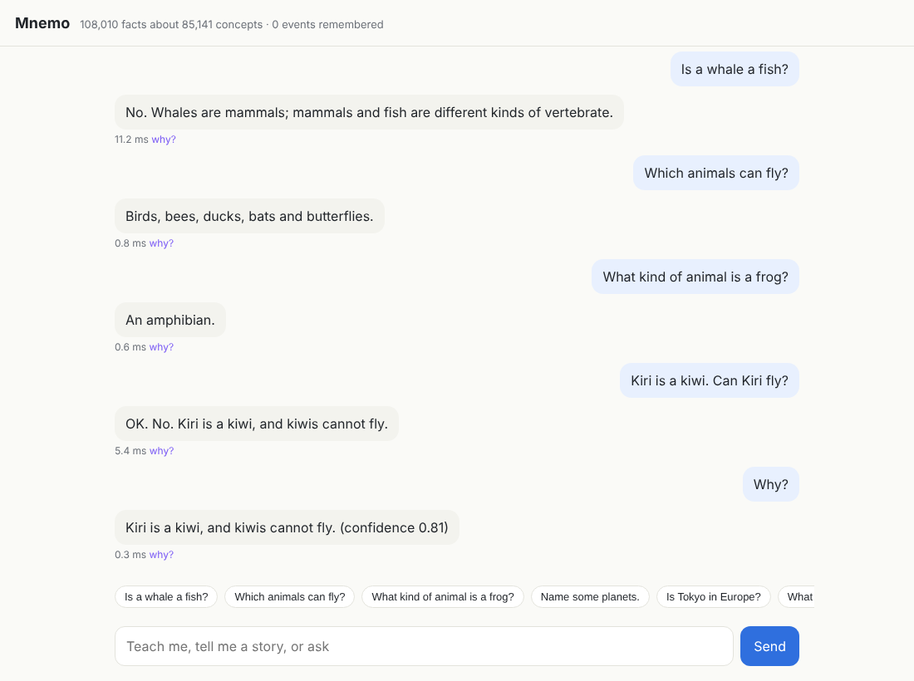

# cpu_slm: Mnemo, a tiny mind that runs on one CPU core

Mnemo is a small, CPU-only system that learns language and reasons in a few
tens of megabytes of memory. Its core contains no neural network: no gradient
descent and no GPU. Every core component is a classic idea from cognitive
science or data compression, built from counting, hashing, hypervectors and
logic, and each learns online from a single pass over its input. An optional
9.3M-parameter LSTM, trained on a CPU in plain numpy, can be mixed in to show
what weight-based learning adds.

* It **predicts text.** On Penn Treebank, with long-term memory frozen, it
  matches the classic Kneser-Ney + cache baseline (125.4 vs 125.7 perplexity).
  Learning online, it beats a small LSTM (113.0 vs 114.5), and it still
  reaches 117.7 in only 35 MB.
* **Counts plus a few weights** do better still. A 9.3M-parameter LSTM,
  trained on the CPU in numpy, scores 79.4 on Penn Treebank. Mixed with
  Mnemo's counts it reaches **69.5**. That beats a 66M-parameter GPU LSTM
  (78.4).
* It **can be fed general knowledge.** WordNet (82k concepts), a curated pack
  of about 870 facts and three open datasets load in 10 s into a 34 MB brain
  (about 320 MB of RAM once loaded). It scored 89% on held-out general-knowledge questions the
  first time they were asked. After fixing what they exposed, it scored 100%
  on a second held-out set, asked once. Each answer takes about 0.2 ms and
  comes with an explanation:
  > *Is a whale a fish?* No. Whales are mammals; mammals and fish are
  > different kinds of vertebrate.
* It **understands how people actually ask.** That includes contractions,
  fragments ("capital of Spain?"), wrapped questions ("could you tell me
  whether…"), lists ("Which animals can fly?"), choices ("Is a tomato a fruit
  or a vegetable?"), "why" questions and exact sums. Typed naturally, a fresh
  set of questions scores 98% on its first run, up from 33% before this
  work. You can chat with it in the browser.
* It is **a generalist** about the world. It reads WordNet's definitions into
  facts:
  * people's years and nationalities;
  * the dates of events;
  * what tools are for;
  * what animals eat and where they live.

  It also imports open data on 250 countries, 32k cities and 119 chemical
  elements. Ask "Who invented the telephone?", "What is the largest country in
  Africa?", "When did World War II end?" or "How many countries border
  Germany?". On a 68-question generalist probe it went from 13 to 67 correct.
  Fresh sets written afterwards scored 76% and then 85% on their first runs.
* On Tiny Shakespeare it scores 2.04 bits per character with learning frozen
  (1.85 online) after 7 s of CPU training. nanoGPT's 10.65M-parameter GPU
  transformer scores 2.12.
* It **compresses losslessly**, so its predictions are honest probabilities.
  Tiny Shakespeare goes to 1.94 bits per character, against 2.36 for bzip2 and
  2.61 for xz.
* It **learns meaning by reading.**
  * happy → glad, pleased, delighted;
  * emma → harriet, knightley, weston (the characters of Austen's *Emma*);
  * france:paris :: germany:berlin;
  * concept clusters of colours, months and royal titles.
* It **remembers facts one-shot and reasons** with uncertainty (defaults,
  exceptions, induction, analogy) and explains every answer.
* It **tracks a changing world** (who is where, who holds what) and passes
  19 bAbI-style story tasks. The stories come from our own generator, not the
  official set.
* It runs on one CPU core: about 40 s to learn the 5 MB Penn Treebank, and
  answers in well under a millisecond.

The full survey, design rationale, measurements and limitations are in
**[RESEARCH.md](RESEARCH.md)**.

## Quick start

```bash
make                       # builds build/mnemo (CLI) and build/libmnemo.so (C99, no deps)
python3 -m mnemo demo      # reasoning tour; needs only numpy
python3 -m mnemo chat      # talk to it: teach facts, tell stories, ask questions
python3 tests/run_tests.py # 49 unit tests (also runnable with pytest)
python3 tests/story_tasks.py 200   # bAbI-style story suite
```

To give it general knowledge (WordNet and the bundled pack):

```bash
scripts/get_data.sh                               # corpora, WordNet 3.0, names, world data
python3 -m mnemo feed --brain models/kbrain       # ~10 s, 200k facts, 34 MB
python3 -m mnemo chat --brain models/kbrain
python3 -m mnemo serve                            # the same in the browser: http://127.0.0.1:8765/
python3 tests/knowledge_probe.py models/kbrain    # 159 general-knowledge questions
python3 tests/natural_probe.py models/kbrain      # 129 questions typed the way people type
python3 tests/general_probe.py models/kbrain      # 182 questions about the wider world
```

To give it language and word meanings, let it read:

```bash
python3 -m mnemo train data/gutenberg/gutenberg/*.txt --semantic --out models/brain
python3 -m mnemo chat --brain models/brain   # now 'complete: Once upon a time' works too
```

To reproduce the language-modelling tables:

```bash
scripts/benchmark.sh                         # results/*.txt and a summary table
python3 tools/kn_reference.py data/ptb/ptb.train.txt data/ptb/ptb.test.txt 5   # KN5 = 141.19
```

## A conversation

```text
you> Tweety is a bird. Birds can fly. Penguins are birds. Penguins can't fly.
mnemo> Noted: penguins cannot fly (an exception to what I would have guessed).
you> Opus is a penguin. Can Tweety fly?
mnemo> Yes. Tweety is a bird, and birds can fly.
you> Can Opus fly?
mnemo> No. Opus is a penguin, and penguins cannot fly.
you> Robins are birds. Robins can sing. Sparrows are birds. Sparrows can sing.
you> Can birds sing?
mnemo> Probably. Judging from robins and sparrows, birds can sing.
you> Why?
mnemo> Judging from robins and sparrows, birds can sing. That is a generalisation from examples, so I am only 62% confident.
you> Mary went to the kitchen. Mary picked up the apple. Mary went to the hallway.
you> Where is the apple?
mnemo> The apple is in the hallway.
you> The currency of the USA is the dollar. The currency of Mexico is the peso.
you> What is the dollar of Mexico?
mnemo> Peso (by analogy: dollar is to USA what peso is to Mexico; similarity 0.26).
```

## Feeding it general knowledge

`python3 -m mnemo feed` fills the declarative memory from three kinds of
source, and keeps the source and confidence of every fact.

* **WordNet 3.0**, from the NLTK data mirror:
  * 82,115 concepts with their definitions;
  * 84,427 is-a links;
  * 25,104 part, substance and place links;
  * opposites, plus capitals, currencies, people's lives, dates, uses and
    diets read from the definitions (see "A generalist" below).
* **Open world data:** countries, cities and chemical elements.
* **`knowledge/general.txt`**, about 870 facts in plain English:
  * animals with their defaults and exceptions;
  * plants, the body, matter and astronomy;
  * 154 countries with capitals, continents, currencies and languages.
* **Your own files**, in any of three formats:
  * plain English, one statement per line: `Penguins cannot fly.`;
  * TSV: `Rome<TAB>capital of<TAB>Italy[<TAB>0.95]`;
  * JSON lines: `{"s": "Lima", "r": "capital_of", "o": "Peru"}`.

```bash
python3 -m mnemo feed --brain models/kbrain my_facts.txt more.tsv   # adds to the brain
```

A dictionary is only useful if the reasoner gets its senses right. Each
WordNet meaning becomes its own concept: "gold" the coins is a different
concept from gold the element, and "China" the country from "china" the
porcelain. The sense of a word is chosen in three ways:
* **From what is already known.** "Chad is a country" means the republic, not
  the lake.
* **One sense per discourse.** Once chosen, a sense is kept for the rest of the
  conversation.
* **The usual sense first.** A clear "no" from it is not overridden by a rare
  sense.

A closed world over curated sibling categories is what lets it say "no"
instead of "I don't know".

```text
you> Is a bat a bird?
mnemo> No. Bats are mammals; mammals and birds are different kinds of vertebrate.
you> Is Tokyo in Europe?
mnemo> No. Tokyo is in Japan, which is in Asia, and Asia is not part of Europe.
you> How many legs does a beetle have?
mnemo> Six. Beetles are insects, and insects have six legs.
you> Who was Mozart?
mnemo> Mozart: prolific Austrian composer and child prodigy; master of the classical style in all its forms of his time (1756-1791). Mozart is a composer, a musician, an artist and a creator. Also called Wolfgang Amadeus Mozart.
you> Kiri is a kiwi.
mnemo> OK.
you> Can Kiri fly?
mnemo> No. Kiri is a kiwi, and kiwis cannot fly.
```

| General-knowledge probe (`tests/knowledge_probe.py`) | Correct |
|---|---|
| dev questions | 37/37 |
| held-out, first run (failures were then fixed) | 57/64 (89%) |
| second held-out set, written after the fixes, run once | 58/58 |

One caveat: these questions are in the phrasing the reader understands, about
what WordNet and the pack cover. The story tasks still score 100% with all
200k facts loaded underneath.

## Asking it naturally, in the browser

`python3 -m mnemo serve` opens a local chat page. It uses the standard library
only, loads nothing from the internet, and binds to localhost. Each answer has
a **why?** link to its reasoning.



People don't ask in the reader's phrasing, so `mnemo/rephrase.py` maps how they
do ask onto it. It strips polite wrappers and embedded questions ("please tell
me what a giraffe is"). It handles checks ("is it true that penguins can't
fly?", with the verdict turned round), fragments, shouting, "how many N are in
a M", and money and language paraphrases. Sums are exact. The mind also
answers the question types people expect:

```text
you> Which animals can fly?
mnemo> Birds, bees, ducks, bats and butterflies.
you> What kind of animal is a whale?
mnemo> A mammal (more precisely, a cetacean).
you> Is a tomato a fruit or a vegetable?
mnemo> Both: tomatoes are fruits and vegetables.
you> Why is a whale not a fish?
mnemo> Because whales are cetaceans, aquatic mammals, placentals and so mammals; mammals and fish are different kinds of vertebrate.
you> Why can a penguin fly?
mnemo> Actually, penguins cannot fly.
you> Do birds have four legs?
mnemo> No. Birds have two legs.
you> Name some countries in Africa.
mnemo> Morocco, Egypt, Ghana, Tunisia, South Africa, Sudan, Madagascar and Mali.
you> What is the difference between a whale and a fish?
mnemo> Whales are mammals, while fish are aquatic vertebrates; both are vertebrates. Whale: any of the larger cetacean mammals having a streamlined body and breathing through a blowhole on the head. Fish: any of various mostly cold-blooded aquatic vertebrates usually having scales and breathing through gills.
you> What is 3 plus 4 times 2?
mnemo> 3 + 4 × 2 = 11.
```

Lists are ranked by familiarity: how often each sense occurs in WordNet's
SemCor counts. That puts "dogs" before "placentals" and oaks before rare kinds
of tree.

| Natural-phrasing probe (`tests/natural_probe.py`) | Correct |
|---|---|
| 73 questions, before this work (baseline) | 24/73 (33%) |
| the same 73 after it (now development data) | 73/73 |
| 56 fresh questions, written afterwards, run once | **55/56 (98%)** |

## A generalist: the wider world

WordNet's 82k definitions say far more than its links do. A small reader in
`mnemo/feed.py` turns their regular shapes into facts:

| A definition says | Fact |
|---|---|
| "English poet and dramatist (1564-1616)" | born 1564, died 1616, English, from the United Kingdom |
| "a war ... from 1939 to 1945"; "the decisive battle ... (1066)" | began / ended, or took place |
| "a hand tool used to deliver an impulsive force by striking" | what a hammer is used for |
| "Australian arboreal marsupial; feeds on eucalyptus leaves" | where koalas live, what they eat |

The reader produces:
* 3,059 birth years and 2,652 nationalities;
* 257 event dates;
* 2,339 purposes.

Three small open datasets, fetched by `scripts/get_data.sh` and kept out of the
repository, add numbers the dictionary lacks:
* [mledoze/countries](https://github.com/mledoze/countries) (ODbL): borders,
  areas, landlocked or not, regions, languages, currencies and demonyms. 195
  of its 250 entries are independent countries; the rest are dependencies.
* [datasets/world-cities](https://github.com/datasets/world-cities) (GeoNames,
  CC BY 3.0): 32k cities in their regions.
* [Periodic-Table-JSON](https://github.com/Bowserinator/Periodic-Table-JSON)
  (CC BY-SA 3.0): symbols, atomic numbers, phases, kinds and discoverers.

Most of the work was matching names to the dictionary's concepts. Pitfalls
that had to be handled:
* a town called Asia in the Philippines must not put the continent there;
* Madrid, Colombia is not the dictionary's Madrid;
* the president is not Lincoln, Nebraska.

```text
you> Who invented the telephone?
mnemo> Alexander Graham Bell: United States inventor (born in Scotland) of the telephone (1847-1922).
you> Who was born first, Newton or Einstein?
mnemo> Newton. Newton was born in 1642, and Einstein was born in 1879.
you> What is the largest country in Africa?
mnemo> Algeria. It has an area of 2,381,741 square kilometres, the largest of the 54 countries in Africa I know.
you> What is the longest river?
mnemo> The Nile: the world's longest river (4150 miles).
you> How many countries border Germany?
mnemo> Nine: Austria, Belgium, Czechia, Denmark, France, Luxembourg, Netherlands, Poland and Switzerland.
you> Does Spain border Germany?
mnemo> No. Spain borders Andorra, France, Gibraltar, Morocco and Portugal.
you> When was the Battle of Hastings?
mnemo> The Battle of Hastings took place in 1066.
you> Which element has atomic number 8?
mnemo> Oxygen: the atomic number of oxygen is 8.
you> Who wrote Hamlet?
mnemo> William Shakespeare, I think: Hamlet is the hero of William Shakespeare's tragedy who hoped to avenge the murder of his father.
you> Who painted the Mona Lisa?
mnemo> I don't know.
```

The last answer is honest: the dictionary never mentions the Mona Lisa.

| Generalist probe (`tests/general_probe.py`) | Correct |
|---|---|
| 68 questions, before this work (baseline) | 13/68 (19%) |
| the same 68 after it (now development data) | 67/68 |
| 68 fresh questions, written afterwards, run once | **52/68 (76%)** |
| 46 more, written after fixing what those exposed, run once | **39/46 (85%)** |

About half of the fresh misses were knowledge the dictionary does not have:
* who invented the telescope;
* who wrote *Romeo and Juliet*;
* where lemurs live.

The other half were general bugs, since fixed and covered by tests. One was
the "I" of "World War I", which was read as the speaker. Another was the
"He" of "the symbol He". Everything else is unchanged:
* the knowledge probe still scores 159/159;
* the natural-phrasing probes score 73/73 and 56/56;
* the story tasks still score 100%, with or without the brain.

Most answers take about 0.3 ms. Searches across all definitions take 20 to
80 ms. RESEARCH.md §15 has the details.

## Weights: a small LSTM next to the counts

`mnemo/neural.py` is a 2×512 word-level LSTM in plain numpy, with
hand-written backpropagation that is gradient-checked in the tests. It has
9.3M parameters, an 18.8 MB file in fp16. It trains on 3 CPU threads at about
7.5 minutes per PTB epoch.

```bash
python3 tools/train_lstm.py --train data/ptb/ptb.train.txt --valid data/ptb/ptb.valid.txt \
    --test data/ptb/ptb.test.txt --out models/lstm_ptb --hidden 512 --dropout 0.5 --epochs 25
./build/mnemo bench --train data/ptb/ptb.train.txt --test data/ptb/ptb.test.txt --spaced \
    --tb 22 --hb 24 --mb 22 --lex 4 --dump models/mnemo_ptb.test.online.f32   # same for valid
python3 tools/hybrid_eval.py --text data/ptb/ptb.test.txt --mnemo models/mnemo_ptb.test.online.f32 \
    --lstm models/lstm_ptb.test_logp.npy --valid-text data/ptb/ptb.valid.txt \
    --valid-mnemo models/mnemo_ptb.valid.online.f32 --valid-lstm models/lstm_ptb.valid_logp.npy
```

On Penn Treebank it reaches 79.4 test perplexity after 25 epochs (about 3
hours). Counting memories remember exactly and adapt within a document. The
LSTM generalises across similar contexts. Because their errors differ, a
simple word-level mixture beats both: **69.5** with Mnemo learning online,
and 72.8 with its long-term memory frozen (see the table below and
RESEARCH.md §12).

## Can it be better than Gemma 1?

**Not in general, and we will not pretend otherwise.** Gemma 1 2B has 2.51
billion weights (about 5 GB), trained on 3 trillion tokens on 512 TPUv5e
chips. On the
[Gemma report](https://storage.googleapis.com/deepmind-media/gemma/gemma-report.pdf)'s
benchmarks it scores:
* MMLU 42.3;
* HellaSwag 71.4;
* ARC-e 73.2;
* GSM8K 17.7;
* HumanEval 22.0.

Mnemo cannot attempt these: it reads a controlled subset of English, does no
arithmetic word problems and writes no code. Its training compute is 10⁷ to
10¹¹ times smaller.

Gemma's weights are also not used here. They are licence-gated, and Hugging
Face and Kaggle are unreachable from this environment. They would also make
the system 200× larger, and a transformer's knowledge cannot be lifted out in
pieces.

**What it is better at, by design and measurably:**
* **Size.** A 34 MB knowledge brain and a 138 MB language cortex.
* **Cost per answer.** About 0.2 ms on one core, against about 5 GFLOPs per
  generated token for a 2.5B-parameter model.
* **One-shot learning.** Tell it a fact once and it is used and saved at once.
* **Exact, explained reasoning** with a confidence, and "I don't know" when
  the evidence is missing.

**How to use a large model with it anyway:** as a teacher. Run Gemma, or any
LLM, on your own machine, and let Mnemo keep only what it can read:

```bash
ollama pull gemma:2b
python3 tools/teacher_pack.py --model gemma:2b --topic volcanoes --topic owls \
    --out knowledge/teacher.txt        # asks for simple statements, filters them
python3 -m mnemo feed --brain models/kbrain --source teacher --conf 0.7 knowledge/teacher.txt
```

The teacher's facts carry a lower confidence, so your own statements and
WordNet win when they disagree. The filter drops chatter, long sentences and
anything the reader cannot parse. The tool also works with any
OpenAI-compatible server (`--api openai`), or on saved output (`--from FILE`).
You can also generate text for the cortex to read, or for the LSTM to train on
(distillation).

RESEARCH.md §13 has the full comparison table.

## How it works

```text
                      text in
                         |
        +----------------v-----------------+
        |  PREDICTIVE CORTEX (C, src/)     |   one pass, online, fixed memory
        |  12-16 context columns (bytes,   |   - bit histories in hashed tables
        |  words, concepts) + MENTAL       |   - Kneser-Ney word expectations
        |  LEXICON + PRIMING + EPISODIC    |   - recency (ACT-R-like decay)
        |  RECALL, pooled by learned gates |   - induction-head-like match model
        +----------------+-----------------+   (+ optional LSTM, mixed per word)
                         | surprise, fluency, plausibility, imagination
        +----------------v-----------------+
        |  LANGUAGE (mnemo/language.py)    |   sentences -> facts / events / questions
        |  WORKING MEMORY (4 entities)     |   pronouns ("she", "they"), word senses
        +---+--------------+-----------+---+
            |              |           |
   +--------v------+ +-----v------+ +--v-----------------+
   | DECLARATIVE   | | EPISODIC   | | SEMANTIC           |
   | facts, NARS   | | events in  | | PPMI + SVD (LSA),  |
   | truth <f,c>,  | | time order,| | concepts, analogy, |
   | ACT-R recall, | | world state| | hypervector codes  |
   | WordNet + pack| |            | |                    |
   +-------+-------+ +-----+------+ +--+-----------------+
           +---------------+-----------+
                           v
                REASONING + ANSWERS (mnemo/mind.py)
   deduction, induction, abduction, revision, transitivity, closed world,
   mental map, HDC analogy, path search, learned motives; "Why?"
```

| Module | Idea | Brain analogue |
|---|---|---|
| `src/cortex.c` | context mixing: many hashed count memories pooled by context-gated weights (PAQ family) | cortical columns voting on the next input |
| `src/lexicon.c` | online interpolated modified Kneser-Ney over words, read out letter by letter through a trie | the mental lexicon (word-superiority effect) |
| priming caches | two exponentially decaying token caches, which approximate power-law forgetting | repetition priming |
| match model | find the last occurrence of the recent context and propose what followed | hippocampal pattern completion; induction heads |
| `mnemo/semantic.py` | PPMI + randomized SVD; spherical k-means concepts | semantic memory (LSA) |
| `mnemo/hdc.py` | bind, bundle, permute, cleanup in 2048-D bipolar space | distributed, compositional codes |
| `mnemo/knowledge.py` | NARS truth values and inference; ACT-R base-level activation; closed world over curated taxonomies | declarative memory |
| `mnemo/feed.py` | WordNet, knowledge packs, fact files; one concept per word sense; definitions read into facts; country, city and element data | schooling: learning from a dictionary, a textbook and an atlas |
| `mnemo/world.py` | ordered event memory; learned motive associations | episodic memory |
| `mnemo/language.py` | pattern parser; 4-slot working memory | language comprehension |
| `mnemo/neural.py` | 2-layer LSTM in numpy, mixed with the counts (optional) | slow, generalising cortical learning |

## Results

Full tables, with sources for every baseline, are in [RESEARCH.md](RESEARCH.md#results).

### Penn Treebank, word level, test perplexity

All Mnemo rows run on one CPU core. Online learning is the analogue of dynamic
evaluation.

| Model | Memory | PPL |
|---|---|---|
| Kneser-Ney 5-gram (published / our reference) | | 141.2 / 141.19 |
| KN5 + cache | | 125.7 |
| RNNLM | | 124.7 |
| LSTM small (Zaremba 2014) | | 114.5 |
| **Mnemo, long-term memory frozen** | 138 MB | **125.4** |
| **Mnemo, online, tiny** | **35 MB** | **117.7** |
| **Mnemo, online, default** | 138 MB | **113.0** |
| **Mnemo, online, large** | 225 MB | **112.0** |
| our LSTM, 2×512, numpy on CPU | 9.3M weights | 79.4 |
| **Mnemo frozen + our LSTM** | 138 MB + 9.3M weights | **72.8** |
| **Mnemo online + our LSTM** | 138 MB + 9.3M weights | **69.5** |

Training takes about 40 s on one core for Mnemo, and about 3 h on 3 cores for
the LSTM. Zaremba et al.'s GPU LSTMs score 82.7 (medium, 20M parameters) and
78.4 (large, 66M).

The rest of the results:
* **WikiText-2.** Kneser-Ney 5-gram, our reference: 220.1. Mnemo with
  long-term memory frozen: 165.5. Mnemo online: **107.5** at 203 MB, and
  **111.0** at 84 MB. A basic LSTM scores about 100.
* **Tiny Shakespeare (character level).** Mnemo frozen: **2.04 bits per
  character**. Mnemo online: **1.85**, and 1.87 at 25 MB. nanoGPT's
  10.65M-parameter GPU transformer: 2.12. bzip2: 2.36.
* **Ablation.** Removing the mental lexicon raises PTB perplexity from 113 to
  162 (online). The word-level expectations matter most.

A sample of imagination, after 46 s of reading 4 MB of 19th-century novels and
children's stories:

> **Once upon a time** there was a great deal to leave the box--he wished to her a bad heart,
> for with a most decided, man for the little the gentleman, and there he saw the sister of
> the bed ...

It is locally fluent and globally incoherent; see Limitations below.

## Repository layout

```text
src/            C engine: cortex.c (context mixing), lexicon.c (word model), main.c (CLI)
mnemo/          Python mind: cortex wrapper, language, knowledge, world, semantic, hdc, CLI,
                feed (WordNet / packs / fact files), neural (numpy LSTM), rephrase (how people
                ask, sums), serve (local chat page)
knowledge/      general.txt, the curated knowledge pack
tests/          unit tests, bAbI-style story suite, general-knowledge, natural-phrasing and
                generalist probes
docs/           screenshots
tools/          kn_reference.py (exact KN5), train_lstm.py, hybrid_eval.py, teacher_pack.py
scripts/        get_data.sh, benchmark.sh
RESEARCH.md     survey + design + results + limitations + roadmap
```

## Limitations

These are stated plainly here, and in more detail in RESEARCH.md:
* **Generated text** is locally fluent but globally incoherent, like any
  n-gram-family model.
* **Hand-written rules.** The parser understands a controlled subset of
  English, widened by rephrasing rules for common ways of asking. Its
  inference rules are designed by hand, not learned. Phrasings outside the
  rules still get "I don't understand that yet".
* **Knowledge.** It knows only what it has been told, has read, or was fed:
  WordNet 3.0 (2006), the pack, and the country, city and element data. It
  has no populations, no current events, no works of art and no sport. The
  definition reader is pattern-based, so a few of its facts are wrong.
* **Story-task scores.** These come from a self-generated suite in bAbI style.
  The official bAbI files were not reachable from this environment.
